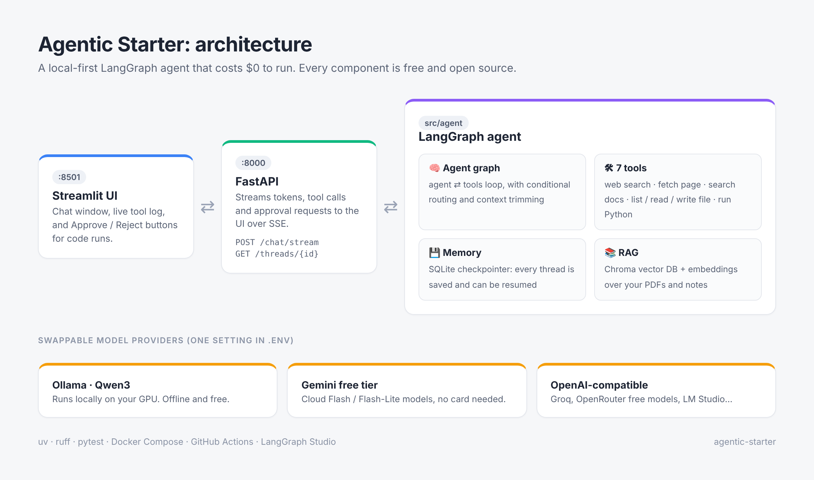
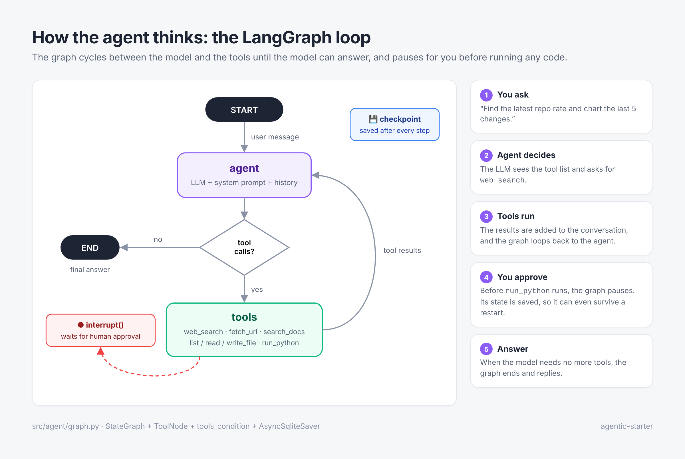
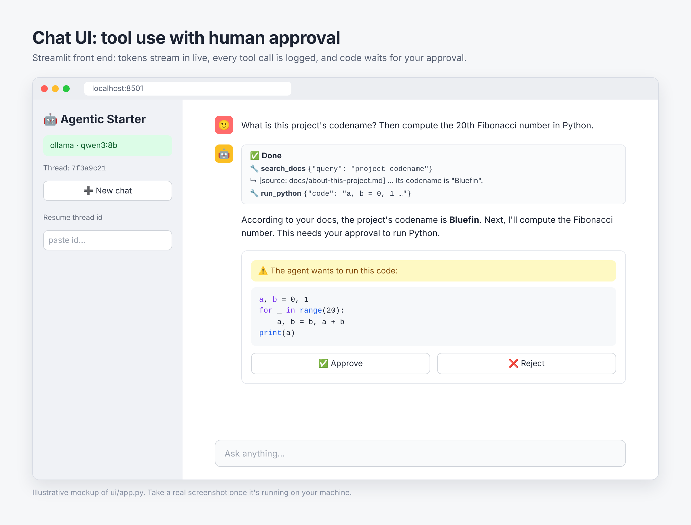

# 🤖 Agentic Starter

**A production-style AI agent built on LangGraph that costs $0 to run.**
It runs fully local on Ollama, or on free cloud tiers (Gemini, Groq, OpenRouter).


You ask a question, and the agent **plans, uses tools, checks the results and keeps going** until the task is done. It searches the web, reads your documents, writes files, and runs Python, but only after you approve the code.



---

## ✨ Features

| | |
|---|---|
| 🧠 **LangGraph agent** | ReAct-style `agent ⇄ tools` loop with conditional routing and context trimming |
| 🛠 **7 tools** | Web search (DuckDuckGo, no key), page fetch, RAG search, file list/read/write, Python execution |
| ✋ **Human-in-the-loop** | `run_python` pauses the graph with `interrupt()` and resumes when you approve |
| 💾 **Persistent memory** | A SQLite checkpointer saves every conversation by `thread_id`, so threads survive restarts |
| 📚 **RAG** | Chroma vector DB + embeddings over your PDFs, Markdown and text files |
| ⚡ **Streaming API** | FastAPI streams tokens, tool calls and approval requests over SSE |
| 💬 **Chat UI** | Streamlit front end with a live tool log and Approve/Reject buttons |
| 🔌 **Swappable models** | Ollama, Gemini free tier, or any OpenAI-compatible API, chosen by one env var |
| 🔍 **Visual debugging** | LangGraph Studio via `make studio` |
| 🧪 **Engineering** | uv, ruff, pytest with a fake LLM (no model needed), Docker Compose, GitHub Actions CI |

---

## 🔁 How the agent works



1. **agent** node: the LLM sees the conversation and the tool list, and decides what to do next.
2. If it asks for tools, the **tools** node runs them and feeds the results back.
3. The loop repeats until the model answers with no tool calls, and then the graph ends.
4. State is **checkpointed after every step**. That is what gives the agent memory and lets it pause for your approval.

The graph lives in [`src/agent/graph.py`](src/agent/graph.py) and is about 60 lines long.

---

## 💬 Chat UI



<sub>Illustrative mockup. Replace it with your own screenshot once the app is running.</sub>

---

## 🚀 Quick start (Linux)

**Requirements:** Python 3.11+, about 8 GB of RAM (16 GB+ recommended). A GPU is optional, but Ollama uses an NVIDIA GPU automatically if you have one.

```bash
git clone https://github.com/<your-username>/agentic-starter.git
cd agentic-starter

make setup     # installs uv + Python deps, creates .env
make models    # installs Ollama, pulls qwen3:8b + nomic-embed-text
make test      # runs the test suite, no model needed
make ingest    # indexes ./docs into the knowledge base
make dev       # API on :8000 + UI on :8501
```

Open **http://localhost:8501** and try:

- *"What is this project's codename?"* (uses RAG over `docs/`)
- *"Search the web for the latest LangGraph release and summarise it."* (web tools)
- *"Write primes.py that prints the first 50 primes, then run it."* (files + code, with approval)

API docs are at **http://localhost:8000/docs**.

### Other ways to run it

<details>
<summary><b>Low RAM or no GPU: use a smaller model</b></summary>

In `.env`:
```env
OLLAMA_MODEL=qwen3:4b
```
</details>

<details>
<summary><b>Gemini free tier (cloud, no GPU needed)</b></summary>

Get a free key at <https://aistudio.google.com>, then in `.env`:
```env
LLM_PROVIDER=gemini
GEMINI_API_KEY=your_key
EMBEDDING_PROVIDER=gemini
```
Note: on the free tier, Google may use your prompts to improve its products.
</details>

<details>
<summary><b>Groq / OpenRouter / LM Studio (OpenAI-compatible)</b></summary>

```env
LLM_PROVIDER=openai_compat
OPENAI_BASE_URL=https://api.groq.com/openai/v1
OPENAI_API_KEY=your_key
OPENAI_MODEL=<a model that supports tool calling>
```
</details>

<details>
<summary><b>Docker (everything in containers, Ollama included)</b></summary>

```bash
cp .env.example .env
make docker
```
</details>

---

## 🧰 Tech stack (all free)

| Layer | Choice |
|---|---|
| Orchestration | [LangGraph](https://github.com/langchain-ai/langgraph) |
| LLM (local) | [Ollama](https://ollama.com) + Qwen3 |
| LLM (cloud) | Gemini Flash / Flash-Lite (free tier) |
| Vector DB | Chroma (embedded) |
| Memory | SQLite checkpointer |
| Web search | DuckDuckGo via `ddgs` |
| Backend | FastAPI + Server-Sent Events |
| Frontend | Streamlit |
| Tooling | uv · ruff · pytest · Docker · GitHub Actions |
| Debugging / tracing | LangGraph Studio · LangSmith (optional, free developer plan) |

---

## 📁 Project structure

```
agentic-starter/
├── src/
│   ├── agent/
│   │   ├── config.py        # settings from .env (pydantic-settings)
│   │   ├── llm.py           # provider factory: ollama | gemini | openai_compat
│   │   ├── prompts.py       # system prompt
│   │   ├── graph.py         # StateGraph: agent node, ToolNode, conditional edges
│   │   ├── rag.py           # Chroma store + ingestion CLI
│   │   ├── studio.py        # LangGraph Studio entry point
│   │   └── tools/           # web · files · code (interrupt) · knowledge
│   └── api/main.py          # FastAPI: /chat/stream, /threads/{id}, /health
├── ui/app.py                # Streamlit chat client
├── tests/                   # tool tests + graph tests with a scripted fake LLM
├── docs/                    # your knowledge-base documents (for RAG)
├── assets/                  # README images
├── docker-compose.yml · Dockerfile · Makefile · langgraph.json
└── .env.example
```

---

## 🛠 Make commands

| Command | What it does |
|---|---|
| `make setup` | Install dependencies and create `.env` |
| `make models` | Install Ollama and pull the models |
| `make dev` | Run the API and UI together |
| `make api` / `make ui` | Run one of them |
| `make ingest` | Index `docs/` for RAG |
| `make studio` | Open LangGraph Studio |
| `make test` / `make lint` / `make fmt` | Quality checks |
| `make docker` | Full stack in Docker |

---

## 🔌 API

```bash
# Start (or continue) a conversation, streamed as SSE
curl -N -X POST localhost:8000/chat/stream \
  -H "Content-Type: application/json" \
  -d '{"thread_id": "demo", "message": "What is 2+2? Use Python."}'

# Approve a pending code run
curl -N -X POST localhost:8000/chat/stream \
  -H "Content-Type: application/json" \
  -d '{"thread_id": "demo", "resume": "yes"}'

# Get a thread's history
curl localhost:8000/threads/demo
```

Event types: `token`, `tool_call`, `tool_result`, `interrupt`, `done` and `error`.

---

## 🧩 Extending

- **Add a tool:** write a function with `@tool` and a clear docstring (the model reads it), then add it to `ALL_TOOLS` in `src/agent/tools/__init__.py`.
- **Add a node:** for example, a `planner` before `agent`, or a `reflect` node that critiques the answer before `END`.
- **Multi-agent:** build researcher and coder subgraphs, then route between them with a supervisor graph.
- **Use MCP servers as tools:** see `langchain-mcp-adapters`.
- **Production database:** swap `AsyncSqliteSaver` for `AsyncPostgresSaver`.
- **Evaluation:** build a small question set and score the answers, for example with LangSmith datasets.

## 🗺 Roadmap

- [ ] Planner → executor → reviewer graph
- [ ] Multi-agent supervisor (researcher + coder)
- [ ] MCP tool integration
- [ ] Evaluation suite with tracked metrics
- [ ] Docker sandbox for `run_python`

---

## ⚠️ Safety

- File tools can only access the `workspace/` folder.
- `run_python` runs real code on your machine. Keep `REQUIRE_APPROVAL=true`, or run the stack in Docker.
- DuckDuckGo search is rate-limited. If searches fail, wait a minute.

## 📄 License

MIT. Use it, fork it, build on it.
